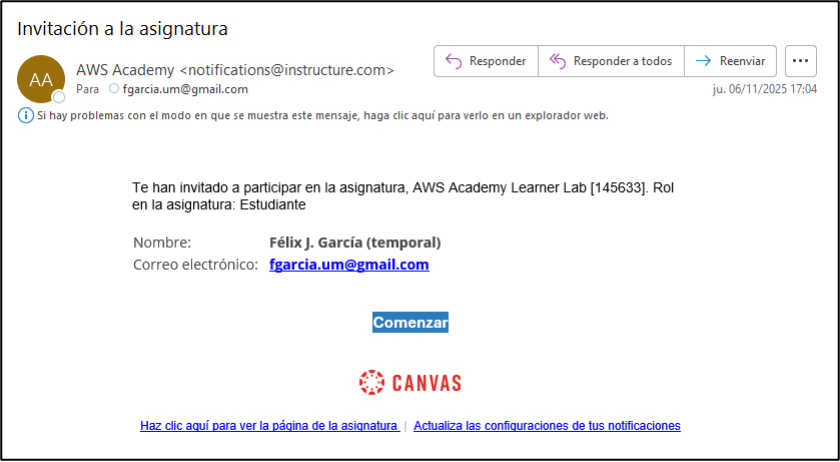
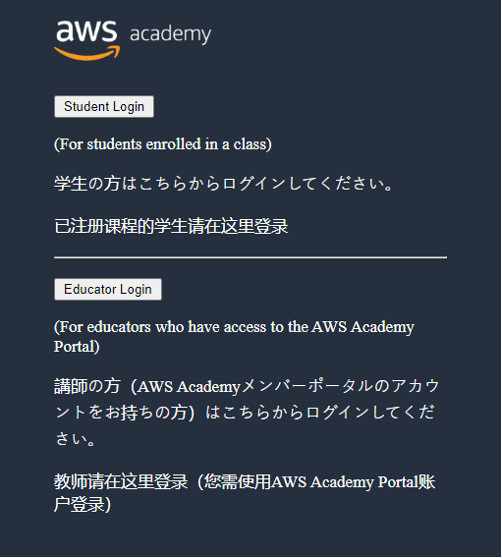
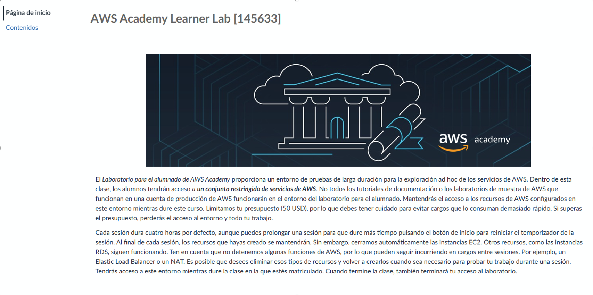
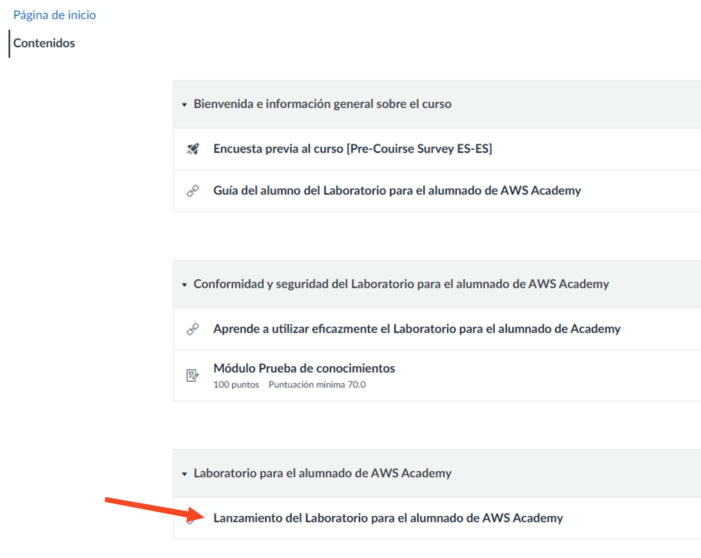
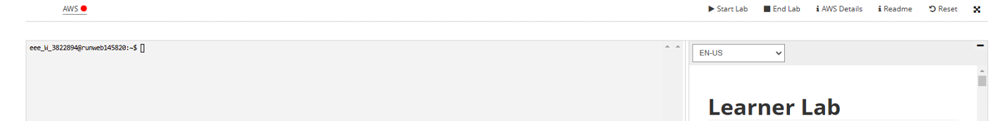
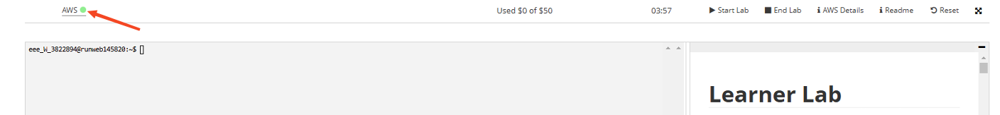

# Acceso a los recursos de AWS a través de AWS Academy

Cada uno de los alumnos de la asignatura recibirá un correo de invitación para acceder al portal web de AWS Academy. Un ejemplo de correo se muestra a continuación:

    

Tras pulsar el enlace _Comenzar_ se accede a una web como la siguiente, donde se debe seleccionar _Student Login_:

    

También puedes acceder a la web principal de AWS Academy mediante este enlace: https://www.awsacademy.com/vforcesite/LMS_Login

Una vez se accede al portal, en el Tablero de asignaturas podrá verse la correspondiente a Prácticas Continuas con el código “AWS Academy Learner Lab [145633]”.

Al acceder a la asignatura encontramos una web que nos permite acceder a los Contenidos a través de un menú lateral.

    

Los contenidos disponibles son los que se muestran a continuación. Con el objetivo de obtener acceso a los recursos AWS, debemos seleccionar el contenido Lanzamiento del Laboratorio para el alumnado de AWS Academy.

    

Tras aceptar los términos de uso, esto nos dará acceso a un portal de Laboratorio como se muestra a continuación.

    

En el Laboratorio debes pulsar el botón Start Lab para lanzar una instancia de la consola AWS. Este proceso tarda unos minutos y podemos verificar que todo ha sido ejecutado correctamente cuando junto a AWS aparece un botón con el color verde.

    

Finalmente, podemos acceder a la consola AWS pulsando sobre las letras AWS (señaladas en la imagen anterior).
