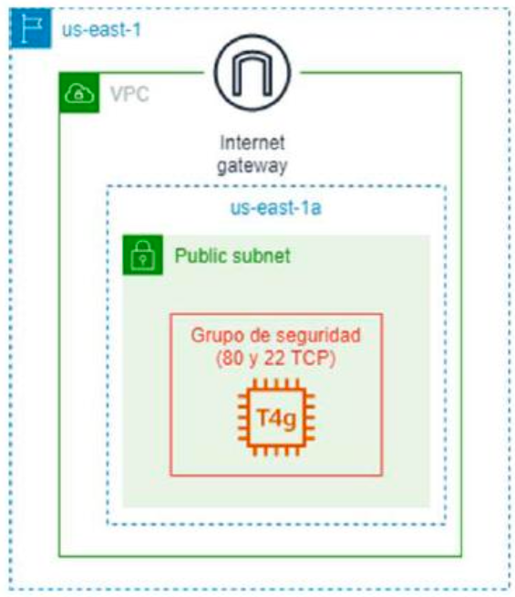
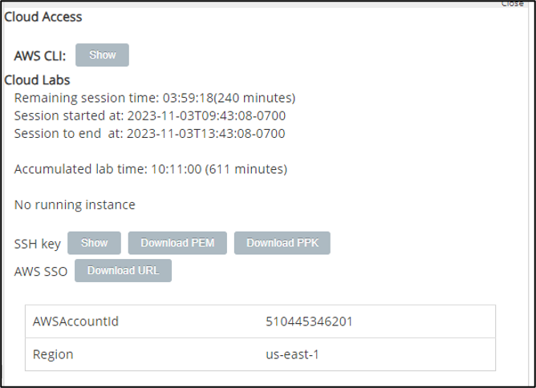
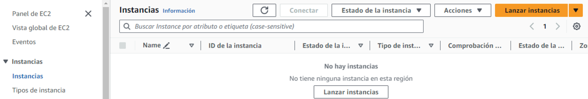
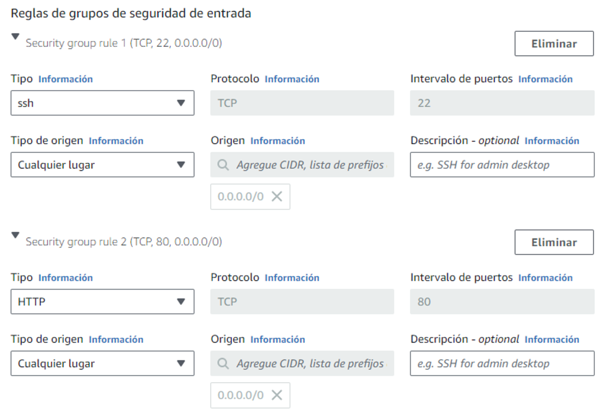
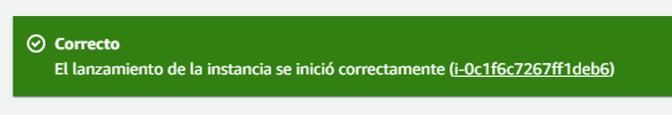
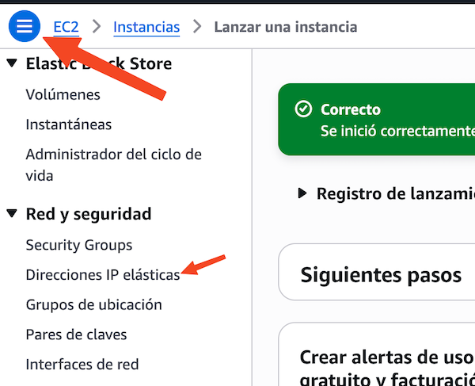
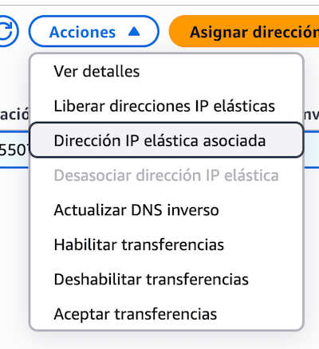

# Boletín 7: Lanzamiento de una instancia EC2 Linux

## Objetivos

El objetivo de esta práctica es el lanzamiento de una instancia de Amazon EC2 en una subred pública, dentro de la VPC por defecto de una región (us-east-1). Tras su lanzamiento, se procederá a la conexión a dicha instancia mediante SSH, y se instalará y habilitará un servidor web.

## Requerimientos

1. Disponer de acceso a los recursos de AWS a través de un sandbox de AWS Academy.
2. Tener instalado la herramienta Putty u otro cliente SSH.

## Arquitectura propuesta

<center>



</center>

## Procedimiento

### Actividad 1. Descargar la clave para conexión por SSH a la instancia EC2

Una vez iniciada la sesión en el laboratorio del sandbox del curso de AWS Academy, es necesario descargar la clave que nos permitirá conectarnos por SSH a la instancia EC2 que vamos a crear. Para ello, hacemos clic en Detalles y mostramos las credenciales temporales del entorno del sandbox. Desde esta ventana, descargamos la clave privada tanto en formato PEM (clientes SSH) como en formato PPK (compatible con Putty). Tras este proceso habremos descargado los archivos labuser.pem y labuser.ppk.

<center>



</center>

### Actividad 2. Confirmamos en qué región AWS estamos trabajando

Abrimos la consola de AWS, presionando el botón AWS y nos aseguramos de que estamos trabajando en la **región `us-east-1` (Norte de Virginia)**.

### Actividad 3. Iniciamos el lanzamiento de una instancia Amazon EC2

Buscamos el servicio Amazon EC2 desde el menú desplegable de Servicios (en la sección Informática) y abrimos la consola del servicio. Una vez allí, hacemos clic sobre Instancias.

Desde la siguiente ventana, hacemos clic en el botón _Lanzar instancias_:

<center>



</center>

### Actividad 4. Seleccionamos la AMI para la instancia Amazon EC2

A continuación, introducimos en el campo Nombre el valor Servidor-web y seleccionamos en el apartado de Imágenes de aplicaciones y sistemas operativos (Amazon Machine Image) la AMI que contendrá la imagen del disco raíz que tendrá nuestra instancia. Elegimos la AMI de Amazon Linux gratuita para arquitectura 64 bits (x86).

### Actividad 5. Seleccionamos el tipo de instancia para la instancia Amazon EC2

Debemos elegir ahora el tipo de la instancia. Debido a las restricciones del sandbox, podemos elegir un tipo muy limitado de instancias. En nuestro caso, elegiremos un tipo de instancia de propósito general, t3.micro.

### Actividad 6. Seleccionamos el par de claves para la instancia Amazon EC2

En el apartado Par de claves (inicio de sesión) seleccionamos la opción marcada como **`vockey`**. La clave pública permanecerá almacenada en la instancia EC2, mientras que nosotros custodiaremos la clave privada (que descargamos en su momento en el apartado 1 de esta práctica).

### Actividad 7. Configuramos la red y el grupo de seguridad para la instancia Amazon EC2

En el apartado Configuraciones de red, se configuran la red y grupo de seguridad (cortafuegos) que se aplicarán a la instancia EC2. Para ello, presionamos el botón Editar, y seleccionamos desde el campo VPC el valor de la VPC predeterminada. En el campo Subred, elegimos una de las subredes que se encuentran en la zona de disponibilidad us-east-1a (en realidad, es indistinto cuál se elija en esta práctica). Verificaremos que el campo Asignar automáticamente IP pública se encuentra en el valor Habilitar.

A continuación, configuraremos el grupo de seguridad de la instancia EC2. Un grupo de seguridad es una entidad de AWS que actúa como cortafuegos a nivel de instancia; los grupos de seguridad nuevos deniegan por defecto todo tráfico entrante a la instancia EC2 y deben configurarse reglas que especifiquen el tráfico permitido. Para ello, desde el apartado Firewall (grupos de seguridad), seleccionaremos la opción Crear grupo de seguridad; asignaremos como Nombre del grupo de seguridad el valor default-vpc-http-ssh; en la Descripción introduciremos Puertos HTTP y SSH. Por último, definiremos dos reglas de entrada para permitir el tráfico a nuestra instancia EC2 por los puertos 80 TCP y 22 TCP, respectivamente:

<center>



</center>

### Actividad 8. Configuramos las opciones de almacenamiento para la instancia Amazon EC2

En el apartado de Configurar almacenamiento, es posible especificar el tamaño del volumen EBS (Elastic Block Storage) raíz, desde donde arrancará nuestra instancia EC2, así como añadir nuevos volúmenes, tanto basados en SSD como en HDD. En nuestro caso, seleccionaremos un volumen de 8 GiB basado en gp3 (General Purpose de 3ª Generación).

### Actividad 9. Lanzamos la instancia Amazon EC2

Por último, desde el cuadro Resumen, seleccionamos el número de instancias (1) y presionamos el botón Lanzar instancia.

### Actividad 10. Comprobamos el estado de la instancia Amazon EC2

A continuación, podremos comprobar que el servicio de Amazon EC2 ha comenzado con el aprovisionamiento de nuestra instancia EC2. Presionamos el botón Ver todas las instancias:

<center>



</center>

Tras ello, el servicio Amazon EC2 comenzará a aprovisionar la instancia, tras un par de minutos, tendremos la instancia operativa desde la consola. Si hacemos clic en el nombre de la instancia podemos ver sus detalles en la parte inferior de la ventana.

### Actividad 11. Asignar una dirección IP elástica a la instancia Amazon EC2

Podemos comprobar que la instancia EC2 dispone de una IP pública (y de una IP privada). Sin embargo, la IP publica es volátil; es decir, si en algún momento la instancia se para y se vuelve a iniciar, obtendrá casi con total probabilidad una IP pública nueva. Este hecho no resulta deseable si necesitamos desplegar un servicio público, ya que tendríamos que proporcionar a nuestros clientes la IP pública cada vez que cambiase. Es por esto por lo que, en AWS, existe el concepto de IP Elástica (Elastic IP, EIP), que es una IP pública y estática. AWS nos permite disponer de hasta 5 EIPs por región (aunque este límite es ampliable). Para crear una EIP, nos dirigimos al apartado Red y Seguridad de la consola de Amazon EC2 y seleccionamos la opción Direcciones IP elásticas.

<center>



</center>

Desde allí, presionamos el botón Asignar la dirección IP elástica. En la siguiente ventana, dejamos la configuración por defecto y presionamos el botón Asignar. Ahora debemos asignar nuestra EIP a nuestra instancia EC2. Para ello, seleccionamos nuestra EIP y, desde el menú de Acciones seleccionamos la opción _Dirección IP elástica asociada_ (mala traducción de "Asociar EIP"):

<center>



</center>

En la siguiente ventana, seleccionamos como Tipo de recurso el valor Instancia, y elegimos nuestra instancia en ejecución. Por último, presionamos el botón Asociar.

Podremos verificar desde la consola de Amazon EC2 que nuestra instancia ya dispone de la EIP.

### Actividad 12. Conectamos por SSH a la instancia Amazon EC2

A continuación, abrimos Putty o una sesión de SSH contra la EIP de la instancia EC2. El nombre de usuario que debe utilizarse para conexión a una instancia EC2 con Amazon Linux 2 es ec2-user. En este caso, con SSH deberíamos introducir desde la línea de comandos o shell:

```bash
ssh -i <ruta_archivo_labuser.pem> ec2-user@<IP_elástica>
```

Si diese un problema de seguridad (sobre todo en Linux), sería necesario cambiar los privilegios del archivo de la clave privada mediante:

```bash
chmod 600 <ruta_archivo_labuser.pem>
```

### Actividad 13. Lanzamos un servidor web en la instancia Amazon EC2

En primer lugar, actualizamos el sistema operativo de la instancia EC2 ejecutando las siguientes órdenes desde la instancia:

```bash
sudo yum update -y
sudo yum upgrade -y
```

A continuación, vamos a instalar el servidor web en la instancia EC2, para ello ejecutamos la orden:

```bash
sudo yum install httpd -y
```

Una vez instalado el servicio HTTP, lo lanzamos y lo habilitamos para que se arranque automáticamente cada vez que la instancia EC2 se inicie. Para ello, ejecutamos las órdenes:

```bash
sudo systemctl start httpd
sudo systemctl enable httpd
```

A continuación, vamos a crear una pequeña página HTML de prueba y la almacenamos como archivo index.html en el directorio del servidor web. Para ello, accedemos como superusuario:

```bash
sudo su
```

E introducimos la orden:

```bash
echo "<h1>Soy la instancia de [vuestro nombre]</h1>" > /var/www/html/index.html
```

Por último, abrimos una ventana de un navegador y accedemos a la IP pública o al nombre DNS público de nuestra instancia y comprobamos que funciona.

### Actividad 14. Limpieza de la práctica

Para eliminar la práctica y que no consuma recursos de AWS, simplemente procedemos a terminar la instancia EC2 que hemos creado. Para ello, desde la consola de Amazon EC2 hacemos clic con el botón derecho del ratón sobre nuestra instancia y seleccionamos Terminar Instancia.

Además, debemos eliminar la IP Elástica, ya que este tipo de recurso consume crédito cuando no está asignada a una instancia EC2 o cuando está asignada a una instancia EC2 parada. Para ello, una vez terminada la instancia, desde el apartado Direcciones IP elásticas, seleccionamos nuestra EIP y desde el menú de Acciones elegimos la opción Liberar direcciones IP elásticas.

Recuerda también que, para hacer un uso responsable de los recursos en la nube, el laboratorio de AWS Academy debe cerrarse presionando el botón End Lab desde la plataforma.

## Entregable

El informe escrito de cada equipo debe presentarse en formato PDF e incluir los elementos listados a continuación:

- Título y autores.
- Realización y explicación de las actividades anteriores.
- Capturas de pantalla que muestren la realización de las actividades anteriores.
- Preguntas cortas:
  - ¿Cuál es el ID de AMI de la instancia?
  - ¿Qué características tiene el tipo de instancia t3.micro?
  - ¿Qué CIDR tiene la subred elegida para la instancia?
  - ¿Qué ID tiene la instancia?
  - ¿Qué IP pública y qué IP privada tiene la instancia tras lanzarla?
  - ¿Qué EIP has asociado a la instancia?
- Intenta hacer un ping a la instancia usando su EIP. ¿Consigues respuesta? ¿Qué tendrías que hacer para obtener respuesta? Hazlo e incluye las pantallas que muestren la solución.
- Conclusiones y reflexiones sobre la experiencia de trabajar con AWS EC2. Por ejemplo, comparación entre el uso de VirtualBox y AWS EC2.
- Declaración del uso de IA (cuáles y para qué).
- Bibliografía (si se utilizaron recursos externos).
