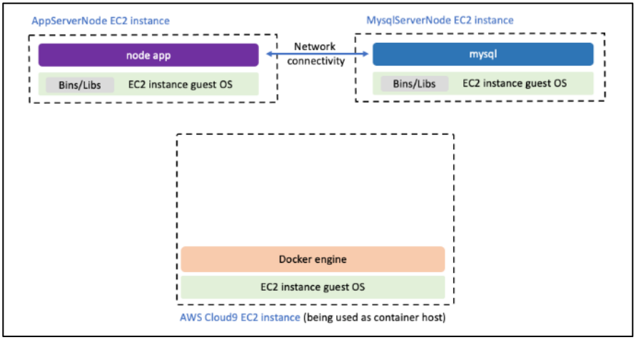
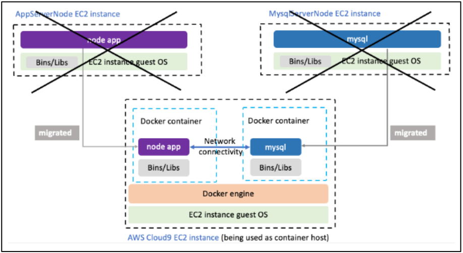
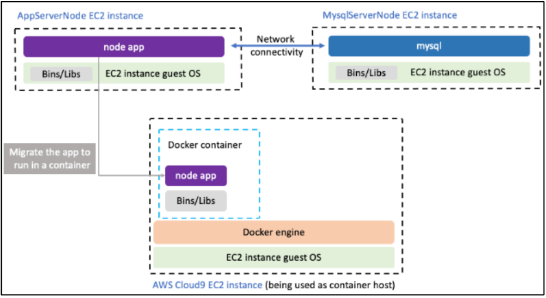
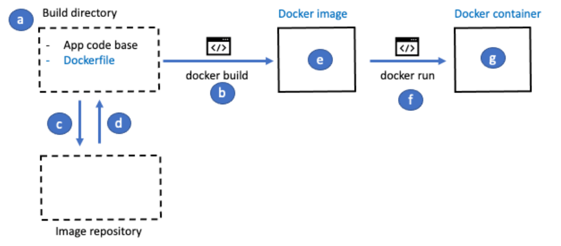
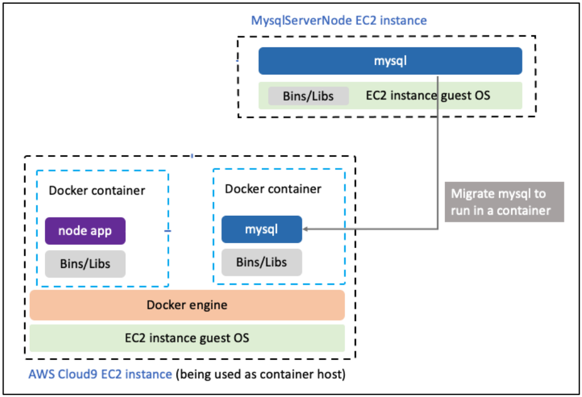

# Boletín 8: Migrando una aplicación Web a Docker

## Objetivos

En este laboratorio, migrarás una **aplicación web** para que se ejecute en **contenedores Docker.** La aplicación está instalada directamente en los sistemas operativos de dos instancias de _Amazon Elastic Compute Cloud (EC2)_. Migrarás la aplicación para que **se ejecute en contenedores Docker.**

Después de completar ese laboratorio, deberías ser capaz de:

- Crear una imagen de Docker utilizando un Dockerfile.
- Ejecutar un contenedor a partir de una imagen de Docker.
- Interactuar y administrar tus contenedores.
- Crear un repositorio en Amazon Elastic Container Registry (ECR).
- Autenticar el cliente de Docker en Amazon ECR.
- Subir una imagen de Docker a Amazon ECR.
- Mediante Amazon ECS, lanzar un contenedor basado en una imagen almacenada en Amazon ECR.

## Requerimientos

1. Disponer de acceso a los recursos de AWS a través de un sandbox de AWS Academy.

## Escenario propuesto

Los propietarios de la cadena de cafeterías CAFE han notado que sus ofertas de café gourmet se han vuelto muy populares entre sus clientes y han decidido comprar a su principal proveedor de este tipo de café.

La empresa adquirida utiliza una aplicación de seguimiento de inventario en una cuenta de AWS. La empresa de software CLOUD ha sido contratada por los propietarios de CAFE para comprender cómo funciona la aplicación y luego crear un plan para integrar la aplicación en la infraestructura de aplicaciones existente de CAFE.

En este laboratorio, debes desempeñar el papel de la empresa CLOUD y trabajarás en migrar la aplicación para que se ejecute en contenedores.

<center>



</center>

Al final de este laboratorio, habrás migrado la aplicación y la base de datos backend para que se ejecuten como contenedores Docker, como se muestra en el siguiente diagrama:

<center>



</center>

Registrarás estos dos contenedores en Amazon ECR para ponerlos a disposición y poder desplegarlos según sea necesario.

## Procedimiento

### Actividad 0. Creamos la aplicación original en AWS

En esta tarea inicial, crearás el escenario original con todas las instancias necesarias en AWS. Harás uso de AWS CloudFormation, una tecnología que estudiaremos en detalle en un tema posterior.

- Busca y abre la consola CloudShell en AWS, realiza los siguientes pasos:
  - Obtén el identificador de usuario:

  ```bash
  aws sts get-caller-identity | jq -r '.Arn'
  ```

  - Copia en un fichero en local el contenido del fichero [stack8.yaml](assets/boletin8/stack8.yaml). Utiliza un editor como nano o vim desde la línea de comandos.
  - Crea la pila CloudFormation y ejecútala con el siguiente comando usando tu identificador de usuario donde se indica <arn_value>:

  ```bash
  aws cloudformation create-stack --stack-name mistack --template-body file://stack8.yaml --parameters ParameterKey=LabUserId,ParameterValue="<arn_value>"
  ```

  - La creación de la aplicación puede llevar un par de minutos. Usa el siguiente comando para verificar que ha terminado el proceso:

  ```bash
  aws cloudformation describe-stacks --stack-name mistack
  ```

  - Debes obtener en la salida del comando anterior el valor "StackStatus": "CREATE_COMPLETE" cuando el proceso finalice.

> **OJO**
>
> La instancia de CloudShell no es accesible desde Internet, ya que solamente dispone de una IP privada.
> Esta herramienta es útil para realizar ajustes y tareas sencillas mediante línea de comandos, pero no es un recurso de computación como EC2.

### Actividad 1. Preparamos el entorno de desarrollo

En esta tarea, configurarás tu entorno de desarrollo para respaldar el trabajo que realizarás en el resto del laboratorio.

- Conéctate a la instancia EC2 de desarrollo.
  - Navega hasta la consola de EC2.
  - Selecciona "Instancias". Observa que hay tres instancias en funcionamiento.
  - Una de las instancias (_DevWorkspaceInstance_) es la instancia de desarrollo.
  - Las otras dos instancias (_MysqlServerNode_ y _AppServerNode_) pertenecen a la aplicación que containerizarás en este laboratorio.
  - Selecciona la instancia _DevWorkspaceInstance_ y copia el valor de la dirección IPv4 pública.
  - Conéctate a la instancia mediante SSH igual que hicimos en la práctica anterior.
- Descarga y extrae los archivos que necesitarás para este laboratorio.
  - Ejecuta el siguiente comando:

  ```bash
  wget https://aws-tc-largeobjects.s3.us-west-2.amazonaws.com/CUR-TF-200-ACCDEV-2-91558/06-lab-containers/code.zip
  ```

  - Extrae el archivo:

  ```bash
  unzip code.zip
  ```

  - Usarás los archivos descargados y extraídos más adelante en este laboratorio.

### Actividad 2. Analizamos la infraestructura de la aplicación existente

En esta tarea, analizarás la infraestructura actual de la aplicación.

- Abre la aplicación del proveedor de CAFE existente en una pestaña del navegador.
  - Navega hasta la consola de EC2.
  - Selecciona la instancia AppServerNode y copia el valor de la dirección IPv4 pública.
  - Abre una nueva pestaña del navegador y navega hasta la dirección IP. El sitio web de los proveedores de CAFE se mostrará.
  - La página utiliza "http://" en lugar de "https://". Tu navegador podría indicar que el sitio no es seguro porque no tiene un certificado SSL/TLS válido. Puedes ignorar la advertencia en este entorno de desarrollo.

- Prueba la funcionalidad de la aplicación web.
  - Selecciona "List of suppliers" y luego "Add a new supplier".
  - Rellena todos los campos con valores. Específicamente para _Nombre_ pon tu nombre y para _Correo electrónico_ pon tu email de la UMU.
  - Selecciona "Submit". Se mostrará la página de "Todos los proveedores" e incluirá el registro que enviaste.
  - Selecciona "Edit" y cambia el registro (por ejemplo, modifica el número de teléfono).
  - Para guardar el cambio, selecciona "Submit". Observa que el cambio se ha guardado en el registro.

- Analiza el código de la aplicación web.
  - También tienes una copia del código de la aplicación que está instalada en la instancia de EC2 AppServerNode en tu instancia de desarrollo.
    - Vuelve al terminal conectado a _DevWorkspaceInstance_.
    - Navega hacia el directorio "resources/codebase_partner/" para ver el código de la aplicación.
  - Para este laboratorio, no es necesario que comprendas los detalles de cómo se construyó la aplicación. Sin embargo, los siguientes detalles podrían ser de interés:
    - La aplicación se creó con Express, que es un marco para desarrollar aplicaciones web.
    - La aplicación se ejecuta en el puerto 80 y está programada en node.js.
    - Para instalar la aplicación directamente en el sistema operativo de la instancia EC2 de Ubuntu Linux AppServerNode, se instalaron node.js y el administrador de paquetes node (npm). Luego, el código que puedes ver en "resources/codebase_partner" se colocó en el servidor y se configuró la conexión a la base de datos de la aplicación.

### Actividad 3. Migrando la aplicación a un contenedor Docker

En esta tarea, migrarás una aplicación que está instalada directamente en el sistema operativo de una instancia EC2 de Ubuntu Linux para que en su lugar se ejecute en un contenedor Docker. El contenedor Docker es portable y podría ejecutarse en cualquier SO que tenga el motor Docker instalado.

<center>



</center>

- Crea un directorio de trabajo para la aplicación de node y mueve el código fuente al nuevo directorio.
  - En la instancia de desarrollo, para crear y navegar a un directorio donde almacenar tu código de contenedor Docker, ejecuta los siguientes comandos:

  ```bash
  mkdir containers

  cd containers
  ```

  - Para crear y navegar a un directorio llamado "node_app" dentro del directorio "containers", ejecuta los siguientes comandos:

  ```bash
  mkdir node_app

  cd node_app
  ```

  - Para mover la base de código, que copiaste anteriormente, al nuevo directorio "node_app", ejecuta el siguiente comando:

  ```bash
  mv ~/resources/codebase_partner ~/containers/node_app
  ```

- Crea un Dockerfile.
  - Para crear un nuevo Dockerfile en el directorio "node_app/codebase_partner", ejecuta el siguiente comando:

  ```bash
  cd ~/containers/node_app/codebase_partner
  nano Dockerfile
  ```

  - Copia y pega el siguiente código en el Dockerfile:

  ```Dockerfile
  FROM node:11-alpine
  RUN mkdir -p /usr/src/app
  WORKDIR /usr/src/app
  COPY . .
  RUN npm install
  EXPOSE 3000
  CMD ["npm", "run", "start"]
  ```

  - Guarda los cambios.

- Construye una imagen a partir del Dockerfile.
  - Ejecuta el siguiente comando:

  ```bash
  docker build --tag node_app .
  ```

- Verifica que se haya creado la imagen de Docker.
  - Para listar las imágenes de Docker, ejecuta el siguiente comando:

  ```bash
  docker images
  ```

  - La salida es similar a la siguiente:

  ```
  REPOSITORY   TAG       IMAGE ID       CREATED         SIZE
  node_app     latest    b57164d4be5f   7 seconds ago   84.5MB
  ```

- Crea y ejecuta un contenedor de Docker basado en la imagen de Docker.
  - Para crear y ejecutar un contenedor de Docker a partir de la imagen, ejecuta el siguiente comando:

  ```bash
  docker run -d --name node_app_1 -p 3000:3000 node_app
  ```

  - Este comando inicia un contenedor con el nombre "node_app_1", utilizando la imagen "node_app" que creaste como plantilla. El argumento "-d" especifica que se debe ejecutar en segundo plano y mostrar el ID del contenedor. El argumento "-p" especifica que se debe publicar el puerto 3000 del contenedor en el puerto 3000 del host (instancia AWS CloudShell).
  - La terminal te mostrará el ID del contenedor, que es una larga cadena de letras y números.
  - Para ver los contenedores de Docker que se están ejecutando actualmente en el host, ejecuta el siguiente comando:

  ```bash
  docker container ls
  ```

- Verifica que la aplicación de node esté funcionando en el contenedor.
  - Para comprobar que el contenedor esté funcionando en el puerto correcto, ejecuta el siguiente comando:

  ```bash
  curl http://localhost:3000
  ```

  - Esto demuestra que la aplicación está en funcionamiento y disponible en el puerto TCP 3000.

- Ajusta el grupo de seguridad de la instancia EC2 de desarrollo para permitir el tráfico de red en el puerto 3000 desde tu computadora.
  - Dado que estás utilizando la instancia EC2 de desarrollo para ejecutar el contenedor, debes abrir el puerto TCP 3000 para el tráfico entrante.
  - Regresa a la pestaña del navegador de la Consola de administración de AWS y navega hasta la consola de EC2.
  - Encuentra y selecciona la instancia _DevWorkspaceInstance_
  - Elige la pestaña Seguridad y selecciona el hipervínculo del grupo de seguridad que comienza con _mistack-DevWorkspaceSecurityGroup-_
  - Elige la pestaña Reglas de entrada y selecciona Editar reglas de entrada.
  - Elige Agregar regla y configura lo siguiente:
    - Tipo: TCP personalizado
    - Rango de puertos: 3000
    - Origen: Mi IP
  - Elige Guardar reglas.
- Accede a la interfaz web de la aplicación, que ahora se está ejecutando en un contenedor.
  - En la consola de EC2, selecciona Instancias y selecciona la instancia _DevWorkspaceInstance_
  - En la pestaña Detalles, copia el valor de la dirección IPv4 pública.
  - Abre una nueva pestaña del navegador. Pega la dirección IP en la barra de direcciones y agrega `:3000` al final de la dirección.
  - La aplicación web se carga en el navegador. Ya has visto esta página antes; sin embargo, anteriormente accediste a la aplicación que se ejecutaba directamente en la instancia EC2 _AppServerNode_. Esta vez accediste a la aplicación que se está ejecutando en un contenedor Docker de la instancia EC2 de desarrollo.

### Actividad 4. Verificando la situación actual

Acabas de completar una serie de pasos con Docker. El siguiente diagrama resume lo que has logrado con Docker hasta ahora.

<center>



</center>

Copiaste la base de código en un directorio, que actuó como tu área de construcción [a]. También creaste un Dockerfile que proporcionó instrucciones sobre cómo crear una imagen de Docker. Luego ejecutaste el comando docker build [b]. Docker leyó el Dockerfile y solicitó la imagen de inicio desde un repositorio de imágenes [c]. El repositorio de imágenes devolvió el archivo de imagen de inicio [d]. El comando docker build luego terminó de construir la imagen según las instrucciones en el Dockerfile, lo que resultó en la imagen de Docker [e]. Finalmente, ejecutaste el comando docker run [f] para ejecutar un contenedor de Docker [g].

Ahora, analiza el problema de conexión con la base de datos. En la aplicación, selecciona "List of suppliers". Verás un error que indica que hubo un problema al recuperar la lista de proveedores. Esto se debe a que el contenedor `node_app_1` tiene problemas para conectarse a la base de datos MySQL, que se está ejecutando en la instancia EC2 llamada _MysqlServerNode_.

### Actividad 5. Migrando la base de datos MySQL a un contenedor Docker

En esta tarea, trabajarás en la migración de la base de datos MySQL a un contenedor. Para llevar a cabo esta tarea, deberás inicializar la base de datos MySQL que se ejecutará en un nuevo contenedor Docker. El siguiente diagrama muestra la migración que llevarás a cabo en esta tarea:

<center>



</center>

- Crea un archivo _mysqldump_ a partir de los datos que se encuentran actualmente en la base de datos MySQL.
  - Ve al panel de control de EC2 y copia el valor de la dirección IPv4 pública de la instancia _MysqlServerNode_.
  - En la terminal de la instancia de desarrollo, ejecuta los siguientes comandos reemplazando <dirección-IP-del-host-de-MySQL> con la dirección IP que copiaste:

  ```bash
  cd ~/containers/node_app/codebase_partner

  docker run --rm -i mysql:8.0 mysqldump -h <dirección-IP-del-host-de-MySQL> -u nodeapp -pcoffee --databases COFFEE > ../../my_sql.sql
  ```

  - Si tienes éxito, la terminal no mostrará ninguna salida. Sin embargo, se habrá creado el archivo `my_sql.sql` en el directorio `~/containers/`.

- En la terminal, para crear un directorio donde almacenar el código de tu contenedor MySQL y navegar hasta el directorio, ejecuta los siguientes comandos:

```bash
cd ~/containers
mkdir mysql
cd mysql
```

- Crea un archivo Dockerfile.
  - Para mover el archivo _sqldump_ al nuevo directorio de MySQL, ejecuta el siguiente comando:

  ```
  mv ../my_sql.sql .
  ```

  - Para crear un nuevo Dockerfile, ejecuta el siguiente comando:

  ```bash
  nano Dockerfile
  ```

  - Copia y pega el siguiente código en el archivo:

  ```Dockerfile
  FROM mysql:8.0.23
  COPY ./my_sql.sql /
  EXPOSE 3306
  ```

  - Guarda los cambios.

- Para construir una imagen a partir del Dockerfile, ejecuta el siguiente comando:

```bash
docker build --tag mysql_server .
```

- Verifica que se haya creado la imagen de Docker. Para listar las imágenes de Docker que tu cliente de Docker conoce, ejecuta el siguiente comando:

```bash
docker images
```

- Crea y ejecuta un contenedor de Docker basado en la imagen de Docker.
  - Para crear y ejecutar un contenedor de Docker a partir de la imagen, ejecuta el siguiente comando:

  ```bash
  docker run --name mysql_1 -p 3306:3306 -e MYSQL_ROOT_PASSWORD=rootpw -d mysql_server
  ```

  - Este comando lanza un contenedor con el nombre "mysql_1", utilizando la imagen `mysql_server` que creaste como plantilla. El parámetro `-e` pasa una variable de entorno.
  - La terminal mostrará el ID del contenedor.
  - Para ver los contenedores de Docker que se están ejecutando actualmente en el host, ejecuta el siguiente comando:

  ```bash
  docker container ls
  ```

  - Ahora se ejecutan dos contenedores. Uno aloja la aplicación node y el otro aloja la base de datos MySQL.

  - Importa los datos en la base de datos MySQL y define un usuario de la base de datos.
    - Ejecuta el siguiente comando (si diera un error la primera línea del fichero sql, borra dicha línea):

    ```bash
    docker exec -i mysql_1 mysql -u root -prootpw mysql < my_sql.sql
    ```

    - Para crear un usuario de la base de datos para que lo utilice la aplicación node, ejecuta el siguiente comando:

    ```bash
    docker exec -i mysql_1 mysql -u root -prootpw -e "CREATE USER 'nodeapp' IDENTIFIED WITH mysql_native_password BY 'coffee'; GRANT all privileges on *.* to 'nodeapp'@'%';"
    ```

### Actividad 6. Testeando el contenedor MySQL con la aplicación Node

En esta tarea, actualizarás la aplicación node que se ejecuta en el contenedor para que apunte a la base de datos MySQL que se ejecuta en el contenedor.

- Para detener y eliminar el contenedor del servidor de la aplicación node, ejecuta el siguiente comando:

```bash
docker stop node_app_1 && docker rm node_app_1
```

- Descubre la información de conectividad de la red. Para encontrar la dirección IPv4 del contenedor mysql_1 en la red, ejecuta el siguiente comando:

```bash
docker inspect bridge
```

- Inicia un nuevo contenedor Docker de la aplicación node.
  - En este paso, ejecutas el comando de Docker para iniciar un nuevo contenedor a partir de la imagen Docker node_app. Sin embargo, esta vez pasas la variable de entorno APP_DB_HOST al entorno del contenedor.
  - Ejecuta el siguiente comando. Reemplaza <dirección-ip> con el valor real de la dirección IPv4 que acabas de descubrir. No es necesario encerrar la dirección IP entre comillas.

  ```bash
  docker run -d --name node_app_1 -p 3000:3000 -e APP_DB_HOST=<dirección-ip> node_app
  ```

- Para verificar que ambos contenedores estén en funcionamiento nuevamente, ejecuta el siguiente comando:

```bash
docker ps
```

- Prueba la aplicación.
  - Abre la aplicación web que se ejecuta como un contenedor en la instancia de desarrollo. La dirección de la aplicación web es: `http://<dirección-ip-pública-DevWorkspaceInstance>:3000`
  - En la aplicación, elige "List of suppliers" para verificar que la base de datos está conectada. Deberías ver los datos que introdujiste en las actividades anteriores.

### Actividad 7. Añadiendo las imágenes Docker a ECR

En esta tarea en el laboratorio, agregarás las imágenes de Docker que creaste a un repositorio de Amazon Elastic Container Registry (Amazon ECR).

- Autoriza a tu cliente Docker de AWS para conectarse al servicio de Amazon ECR.
  - Descubre el ID de tu cuenta de AWS.
    - En la Consola de administración de AWS, en la esquina superior derecha, elige tu nombre de usuario. Tu nombre de usuario comienza con voclabs/user.
    - Copia el valor de "ID de cuenta" del menú.
  - A continuación, regresa a la terminal de la instancia de desarrollo.
  - Para autorizar a tu cliente Docker de la instancia de desarrollo, ejecuta el siguiente comando. Reemplaza <account-id> con el ID de cuenta real que acabas de encontrar:

  ```bash
  aws ecr get-login-password --region us-east-1 | docker login --username AWS --password-stdin <account-id>.dkr.ecr.us-east-1.amazonaws.com
  ```

- Para crear el repositorio:
  - Ejecuta el siguiente comando:

  ```bash
  aws ecr create-repository --repository-name node-app
  ```

  - Los datos de respuesta están en formato JSON e incluyen un valor de `repositoryArn`. Esta es la URI que utilizarás para hacer referencia a tu imagen en futuros despliegues.
  - La respuesta también incluye un `registryId`, que utilizarás en un momento.

- Etiqueta la imagen de Docker.
  - En este paso, etiquetarás la imagen con tu valor único de `registryId` para facilitar la gestión y el seguimiento de esta imagen.
  - Ejecuta el siguiente comando. Reemplaza <registry-id> con tu número de ID de registro real.

  ```bash
  docker tag node_app:latest <registry-id>.dkr.ecr.us-east-1.amazonaws.com/node-app:latest
  ```

  - Para verificar que se aplicó la etiqueta, ejecuta el siguiente comando:

  ```bash
  docker images
  ```

  - Esta vez, observa que se aplicó la etiqueta "latest" y el nombre de la imagen incluye el nombre del repositorio remoto donde tienes la intención de almacenarla.

- Sube la imagen de Docker al repositorio de Amazon ECR.
  - Para subir tu imagen a Amazon ECR, ejecuta el siguiente comando. Reemplaza <registry-id> con tu número de ID de registro real:

  ```bash
  docker push <registry-id>.dkr.ecr.us-east-1.amazonaws.com/node-app:latest
  ```

- Para confirmar que la imagen "node-app" está ahora almacenada en Amazon ECR, ejecuta el siguiente comando `aws ecr list-images`. El comando devuelve información sobre la imagen que acabas de cargar.

```bash
aws ecr list-images --repository-name node-app
```

- Usa la consola de AWS para acceder al menú de Amazon ECR y comprobar que la imagen está almacenada.

### Actividad 8. Lanzando el contendor Docker usando ECR y ECS

En esta tarea final, vamos a lanzar únicamente un contendor Docker basado en la imagen almacenada en el ECR y haciendo uso de Amazon Elastic Container Service (Amazon ECS).

- Define una tarea para lanzar el contenedor.
  - Desde la consola de AWS accede a **Amazon ECS**, selecciona el menú "Definiciones de tareas" y presiona el botón "Crear una nueva definición de
    tarea".
  - Utiliza los siguientes datos:
    - Requisitos de infraestructura:
      - **Familia:** `mytask_appnode`
      - **Tipo de lanzamiento:** AWS Fargate
      - **Sistema operativo/arquitectura:** Linux/X86_64
      - **Tamaño de la tarea:** 1 vCPU y 3 GB
      - **Rol de tarea:** `LabRole`
      - **Rol de ejecución de tareas:** `LabRole`
    - Contenedores:
      - **Nombre del contenedor:** `appnode`
      - **URI de imagen:** `<registry-id>.dkr.ecr.us-east-1.amazonaws.com/node-app:latest`
      - **Puerto del contenedor:** 3000
    - Deja el resto de datos con su valor por defecto.
  - Reemplaza <registry-id> con tu número de ID de registro real que utilizaste en la actividad anterior.
  - Presiona "Crear" al final del formulario. Una vez esté activa la tarea, podrá verse el estado _Active_ en la consola.
  - Si seleccionas JSON, podrás ver la definición de la tarea.

- Crea un clúster para la ejecución de la tarea.
  - Selecciona el menú "Clústeres" y presiona el botón "Crear clúster".
  - Ignora el error "Se ha producido un error al recuperar una lista de espacios de nombres" si se produce.
  - Utiliza los siguientes datos:
    - **Nombre del clúster:** `DevCluster`
    - **Infraestructura:** "Solo Fargate"
    - Deja el resto de opciones con su valor por defecto.

- Crea el servicio definido por la tarea.
  - Selecciona nuevamente el menú "Definiciones de tareas" y selecciona la tarea que creaste previamente.
  - Selecciona "Implementar" y después "Crear Servicio".
  - Utiliza los siguientes datos:
    - **Nombre del servicio:** `myservice_appnode`
    - **Clúster existente:** DevCluster
    - **Opciones informáticas:** Tipo de lanzamiento
    - **Tipo de lanzamiento:** FARGATE
    - **Tareas deseadas:** 1
    - **Redes:**
      - Crear un nuevo grupo de seguridad para permitir la **conexión TCP al puerto 3000** desde cualquier lugar.
      - **IP pública:** Activado
    - Deja el resto de datos con su valor por defecto.
  - Pulsa en "Crear" al final del formulario. La creación puede tardar algunos minutos en completarse.

- Tras crear el servicio, accede a la sección "Tareas" desde el clúster, después a "Detalles del contenedor para appnode" y selecciona "Enlaces de red". Verás el enlace externo para abrir la aplicación web (botón "dirección abierta"). **Abre la aplicación web en tu navegador.**

### Actividad 9. Limpieza de la práctica

Para eliminar la práctica y que no consuma recursos de AWS, simplemente procedemos a terminar los recursos que hemos creado. Para ello, desde CloudShell, usa el siguiente comando:

```bash
aws cloudformation delete-stack --stack-name mistack
```

También debemos eliminar los servicios creados en Amazon ECS. Para ello, desde la consola de Amazon ECS selecciona el clúster que has creado, elimina el servicio asociado y finalmente el propio clúster.

Recuerda también que, para hacer un uso responsable de los recursos en la nube, el laboratorio de AWS Academy debe cerrarse presionando el botón "End Lab" desde la plataforma.

## Entregable

El informe escrito de cada equipo debe presentarse en formato PDF e incluir los elementos listados a continuación:

- Título y autores.
- Realización y explicación de las actividades anteriores.
- Capturas de pantalla y salida de los comandos más significativos que muestren la realización de las actividades anteriores.
- Preguntas cortas:
  - En la Actividad 2, ¿qué tipo de estancia EC2 se han creado para la aplicación original?
  - En la Actividad 3, analiza el Dockerfile creado e indica que significado tiene cada línea.
  - En la Actividad 5, analiza el Dockerfile creado e indica que significado tiene cada línea.
  - En la Actividad 6, ¿cuál es la subred IP usada por los contenedores para comunicarse?
  - En la Actividad 8, ¿qué componentes opcionales no has utilizado cuando has creado el servicio? ¿qué utilidad tiene cada uno de ellos?
- Preguntas que requieren razonamiento:
  - Como puedes comprobar, la aplicación web no está completa en el entorno AWS cuando se despliega con ECS. ¿Qué debería hacerse para completar la instalación de la aplicación en Amazon ECS?
  - Si tuviéramos _Docker Compose_ disponible en la instancia de desarrollo, ¿podríamos mejorar el despliegue de los contenedores? Razona tu respuesta.
  - Localiza el repositorio `node-app` y la imagen _latest_ en ECR en la consola AWS. Dentro de la sección "Detalles de la imagen", selecciona _Analizar_. ¿Qué tipo de análisis ha realizado y que resultado muestra el análisis?
  - En el lanzamiento del contenedor desde ECS, ¿qué tipo de infraestructura has utilizado para su lanzamiento? ¿has necesitado especificar el tipo de instancias EC2 a utilizar? Razona tu respuesta.
- Declaración del uso de IA (cuáles y para qué).
- Bibliografía (si se utilizaron recursos externos).
